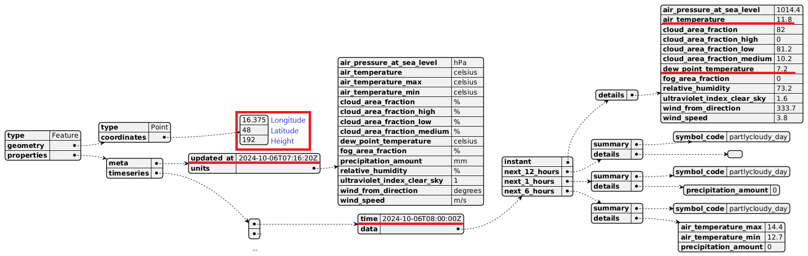

## Lesen von Daten einer Web API mit Interfaces

In diesem Abschnitt wird gezeigt, wie man Daten von einer Web-API liest und sicherstellt, dass die Antwort der API dem erwarteten Interface entspricht. Dazu verwenden wir das Interface, um die Struktur der Daten zu beschreiben, die von der API bereitgestellt werden.

Angenommen, wir rufen Daten von der folgenden API auf: `https://localhost:5443/api/Categorie`. Diese API gibt eine Liste von Kategorien zurück, die beispielsweise wie folgt aussieht:

```json
[
  {
    "guid": "00000000-0000-0000-0000-000000000001",
    "name": "Work",
    "description": "Tasks related to your professional or business activities.",
    "isVisible": true,
    "priority": "High",
    "ownerName": "guest"
  },
  {
    "guid": "00000000-0000-0000-0000-000000000002",
    "name": "Personal",
    "description": "Tasks related to personal life, not connected to work.",
    "isVisible": true,
    "priority": "Medium",
    "ownerName": "guest"
  }
]
```

### Definition des Interfaces für die API-Daten

Zuerst definieren wir ein Interface, das die Struktur der Daten beschreibt:

```typescript

enum Priority {
    Low = "Low",
    Medium = "Medium",
    High = "High"
}

interface Category {

    guid: string;
    name: string;
    description: string;
    isVisible: boolean;
    priority: Priority;
    ownerName: string;
}
```


## Type Guards

In TypeScript gibt es sogenannte **Type Guards**, die verwendet werden, um sicherzustellen, dass ein Objekt oder eine Variable einen bestimmten Typ hat. Type Guards sind Funktionen oder Bedingungen, die TypeScript helfen, den Typ einer Variable während der Laufzeit zu bestimmen und den Code entsprechend zu analysieren.

### Benutzerdefinierte Type Guards

Ein besonders nützliches Feature in TypeScript sind benutzerdefinierte Type Guards. Diese Funktionen geben an, dass ein Objekt einem bestimmten Interface oder Typ entspricht, wenn bestimmte Bedingungen erfüllt sind.

Die Syntax `obj is Category` in der Funktion `isCategory(obj: any): obj is Category` definiert so eine Typ-Wache. Das bedeutet, dass die Funktion `isCategory` überprüft, ob das übergebene `obj` dem Interface `Category` entspricht.

### Beispiel: Type Guard mit `isCategory`

Hier ist ein Beispiel, wie Type Guards mit einem benutzerdefinierten Interface wie `Category` verwendet werden können:

```typescript

enum Priority {
    Low = "Low",
    Medium = "Medium",
    High = "High"
}

interface Category {

    guid: string;
    name: string;
    description: string;
    isVisible: boolean;
    priority: Priority;
    ownerName: string;
}

function isCategory(obj: any): obj is Category {
    return typeof obj.guid === 'string' &&
           typeof obj.name === 'string' &&
           typeof obj.description === 'string' &&
           typeof obj.isVisible === 'boolean' &&
           obj.priority === Priority.Low || obj.priority === Priority.Medium || obj.priority === Priority.High &&
           typeof obj.ownerName === 'string';
}
```

### Erklärung:
- **`obj: any`**: Das Argument `obj` kann beliebige Daten enthalten, typisiert als `any`.
- **`obj is Category`**: Der Rückgabewert `obj is Category` bedeutet, dass die Funktion prüft, ob `obj` dem Interface `Category` entspricht. Wenn die Funktion `true` zurückgibt, geht TypeScript davon aus, dass das Objekt `obj` den Typ `Category` hat.

### Verwendung eines Type Guards:

Nachdem die Type-Guard-Funktion definiert wurde, kann sie verwendet werden, um Objekte sicher zu prüfen und zu typisieren:

```typescript
const data: any = {
    guid: "00000000-0000-0000-0000-000000000001",
    name: "Work",
    description: "Tasks related to work",
    isVisible: true,
    priority: "High",
    ownerName: "guest"
};

if (isCategory(data)) {
    console.log(data.name);  // TypeScript weiß jetzt, dass 'data' ein 'Category' ist
} else {
    console.log("Data is not of type Category");
}
```

### Warum Type Guards verwenden?
Type Guards sind nützlich, weil sie die Typensicherheit verbessern und TypeScript helfen, Typen zur Laufzeit zu analysieren. Anstatt überall `any`-Typen zu verwenden, kann man mit Type Guards sicherstellen, dass Variablen und Objekte den erwarteten Typen entsprechen, bevor sie verwendet werden.

Dies erhöht die Sicherheit und Stabilität im Code und hilft, Laufzeitfehler zu vermeiden, indem der Code zur Entwicklungszeit besser überprüft wird.

## Beispielprojekt: Lesen von der WebAPI

Wir möchten nun von unserem Backend, das in [30_TodoApp/01_Backend.md](../30_TodoApp/01_Backend.md) beschrieben ist, Daten lesen.
Dafür ist es nötig, dass das Backend läuft und im Browser unter der Adresse *https://localhost:5443/swagger* erreichbar ist.

Nun legen wir wie bei ["Die erste Typescript App"](./10_FirstApp.md) ein Projekt mit dem Namen *todo_client* an.
Zusätzlich brauchen wir noch das Paket *node-fetch*, das wir im Verzeichnis *todo_client* mit folgendem Befehl installieren können:

```bash
npm install node-fetch
```

Der Source Code der Anwendung ist folgender:

**src/app.ts**
```typescript
import fetch from 'node-fetch';
import https from 'https';

enum Priority {
    Low = "Low",
    Medium = "Medium",
    High = "High"
}

interface Category {
    guid: string;
    name: string;
    description: string;
    isVisible: boolean;
    priority: Priority;
    ownerName: string;
}

const agent = new https.Agent({
    rejectUnauthorized: false  // Ignoriert das selbstsignierte Zertifikat
});

// Hilfsfunktion zur Typüberprüfung
function isCategory(obj: any): obj is Category {
    return typeof obj.guid === 'string' &&
        typeof obj.name === 'string' &&
        typeof obj.description === 'string' &&
        typeof obj.isVisible === 'boolean' &&
        (obj.priority === Priority.Low || obj.priority === Priority.Medium || obj.priority === Priority.High) &&
        typeof obj.ownerName === 'string';
}

async function fetchCategories(): Promise<Category[]> {
    const response = await fetch('https://localhost:5443/api/categories', { agent });
    if (!response.ok) {
        throw new Error('Fehler beim Abrufen der Daten');
    }
    const data = await response.json();
    // Überprüfen, ob die Antwort dem Category-Interface entspricht
    if (Array.isArray(data) && data.every(isCategory)) {
        return data;
    } else {
        throw new Error('Invalid data from server.');
    }
}

// Start fetching the categories
const categories = await fetchCategories();
for (const category of categories) {
    console.log(`Category ${category.name} with guid ${category.guid}`);
}

```

Das Projekt kann nun im Verzeichnis *todo_client* mit dem Startskript in der Konsole gestartet werden:

```bash
npm run start
```

```
Category Work with guid 00000000-0000-0000-0000-000000000001
Category Personal with guid 00000000-0000-0000-0000-000000000002
Category Health with guid 00000000-0000-0000-0000-000000000003
Category Home with guid 00000000-0000-0000-0000-000000000004
Category Finance with guid 00000000-0000-0000-0000-000000000005
```

## Übung

Du brauchst für diese Übung das Backend der Todo App wie auf [01_Backend.md](../30_TodoApp/01_Backend.md) beschrieben.
Stelle vorher sicher, dass die API unter *https://localhost:5443/swagger* erreichbar ist.

Erstelle ein Verzeichnis *todo_tasks* und initialisiere die App wie [bei der ersten App](./10_FirstApp.md) beschrieben.
Installiere mit *npm install node-fetch* das Paket *node-fetch*.

Die App soll die URL *https://localhost:5443/api/TodoItems* anfordern und die folgenden Daten aus der
Antwort ausgeben: *guid, title, description, categoryName, isCompleted und dueDate.*
Es sind nur die ersten 10 TodoItems auszugeben.

Rufe für jeden Datensatz in der Schleife die URL *https://localhost:5443/api/TodoItems/(guid)* mit *fetch* auf.
guid ist durch die gelesene GUID des TodoItems zu ersetzen.
Beim Detail Request bekommst du nochmals die Daten des TodoItems und ein Array mit den TodoTasks.
Gib alle *todoTasks* mit den Feldern *guid, title, isCompleted, dueDate* aus.

Beachte bei der Implementierung folgendes:
- Definiere ein Interface TodoItem für die Antwort von *https://localhost:5443/api/TodoItems*.
  Es sollen nur die Felder, die ausgegeben werden, berücksichtigt werden.
- Definiere ein Interface für die Todo Tasks für die Antwort von *https://localhost:5443/api/TodoItems/(guid)*.
  Beachte, dass von der Serverantwort nur der Key *todoTasks* verwendet werden soll.
- Schreibe für jedes Interface type guard Funktionen: *isTodoItem* und *isTodoTask*.
- Die Funktion *fetchTodoItems* liefert den Typ *Promise&lt;TodoItem[]&gt;*
- Die Funktion *fetchTodoTasks* bekommt die GUID des Tasks als Argument und liefert den Typ *Promise&lt;TodoTask[]&gt;*

### Ausgabe

Das Backend erzeugt die Datumswerte beim Start relativ zum aktuellen Datum.
Deine Ausgabe hat daher andere Werte bei *dueDate*.

```
Item 00000000-0000-0000-0001-000000000001: Without Tasks
Desc: TodoItem without tasks
categoryName: Work, isCompleted: false, dueDate: null
Tasks:

----------------------------------------------------------------------

Item 3b33199e-bc34-7895-eb67-338383c35c99: Annual check-up at the doctor
Desc: Yearly health check with the family doctor. The blood test must be done in the morning before breakfast.
categoryName: Health, isCompleted: false, dueDate: 2026-11-30T13:00:00
Tasks:
Task Call the doctor's office for an appointment, dueDate: 2026-10-01T13:00:00, isCompleted: true
Task Fill in the health questionnaire, dueDate: 2026-10-21T13:00:00, isCompleted: true
Task Go to the blood test, dueDate: 2026-11-10T13:00:00, isCompleted: false
Task Discuss the results with the doctor, dueDate: 2026-11-30T13:00:00, isCompleted: false

----------------------------------------------------------------------

Item 7749fda6-bbef-5721-49a8-a8e5819ac533: Prepare quarterly sales presentation
Desc: Slides for the quarterly meeting with the management. Focus on the new customers in Vienna and Graz.
categoryName: Work, isCompleted: false, dueDate: 2026-11-29T17:00:00
Tasks:
Task Export sales figures from the CRM, dueDate: 2026-09-28T17:00:00, isCompleted: true
Task Create charts for revenue by region, dueDate: 2026-10-13T17:00:00, isCompleted: true
Task Write speaker notes, dueDate: 2026-10-29T17:00:00, isCompleted: true
Task Rehearse the presentation with Anna, dueDate: 2026-11-14T17:00:00, isCompleted: true
Task Send the slides to the team lead for review, dueDate: 2026-11-29T17:00:00, isCompleted: false

----------------------------------------------------------------------

Item 27bdba69-e768-6061-4df7-25335b9dddab: Plan summer vacation in Croatia
Desc: Two weeks at the coast next summer. We travel by car and want to visit Split and Hvar.
categoryName: Personal, isCompleted: false, dueDate: 2027-01-04T11:00:00
Tasks:
Task Agree on travel dates with the family, dueDate: 2026-10-06T11:00:00, isCompleted: true
Task Book an apartment in Split, dueDate: 2026-10-28T11:00:00, isCompleted: true
Task Book ferry tickets to Hvar, dueDate: 2026-11-20T11:00:00, isCompleted: false
Task Buy the vignette for Slovenia, dueDate: 2026-12-12T11:00:00, isCompleted: false
Task Write a packing list, dueDate: 2027-01-04T11:00:00, isCompleted: false

----------------------------------------------------------------------

Item a2786a5c-f8f7-e9f0-e4ca-b143b9c855b8: Repair dripping kitchen tap
Desc: The kitchen tap has been dripping for a week. Probably the washer is broken.
categoryName: Home, isCompleted: false, dueDate: 2026-11-16T10:00:00
Tasks:
Task Turn off the water supply, dueDate: 2026-09-30T10:00:00, isCompleted: true
Task Buy a new washer at the hardware store, dueDate: 2026-10-15T10:00:00, isCompleted: true
Task Replace the washer, dueDate: 2026-10-31T10:00:00, isCompleted: true
Task Check for leaks, dueDate: 2026-11-16T10:00:00, isCompleted: false

----------------------------------------------------------------------

Item 9a42a0ae-138f-0267-79a5-714ec54d721d: File tax return for last year
Desc: Employee tax assessment via FinanzOnline. Costs for the home office and training courses can be deducted.
categoryName: Finance, isCompleted: false, dueDate: 2026-12-15T15:00:00
Tasks:
Task Collect receipts for training courses, dueDate: 2026-10-03T15:00:00, isCompleted: true
Task Download the annual pay slip (L16), dueDate: 2026-10-21T15:00:00, isCompleted: true
Task Enter the expenses in FinanzOnline, dueDate: 2026-11-09T15:00:00, isCompleted: true
Task Submit the tax return, dueDate: 2026-11-27T15:00:00, isCompleted: false
Task Check the tax assessment notice, dueDate: 2026-12-15T15:00:00, isCompleted: false

----------------------------------------------------------------------

Item db276584-a83e-a245-9f83-12e372168300: Write monthly project report
Desc: Monthly report for the customer about progress, budget and risks of the project.
categoryName: Work, isCompleted: true, dueDate: 2026-10-31T13:00:00
Tasks:
Task Collect hours from the time tracking tool, dueDate: 2026-09-27T13:00:00, isCompleted: true
Task Summarize finished milestones, dueDate: 2026-10-09T13:00:00, isCompleted: true
Task List open risks, dueDate: 2026-10-20T13:00:00, isCompleted: true
Task Send the report to the customer, dueDate: 2026-10-31T13:00:00, isCompleted: true

----------------------------------------------------------------------

Item 5b26abef-fe84-94fb-f35e-e469bf86e1b5: Train for the Vienna City Marathon
Desc: Goal: finish the half marathon in under two hours. The training plan has four runs per week.
categoryName: Health, isCompleted: false, dueDate: 2027-01-19T17:00:00
Tasks:
Task Register for the half marathon, dueDate: 2026-10-08T17:00:00, isCompleted: true
Task Buy new running shoes, dueDate: 2026-10-29T17:00:00, isCompleted: true
Task Run 10 km without a break, dueDate: 2026-11-18T17:00:00, isCompleted: false
Task Run 15 km in under 1:30 h, dueDate: 2026-12-09T17:00:00, isCompleted: false
Task Do an 18 km long run, dueDate: 2026-12-30T17:00:00, isCompleted: false
Task Rest two days before the race, dueDate: 2027-01-19T17:00:00, isCompleted: false

----------------------------------------------------------------------

Item 417df495-f3ca-3f51-454b-d16562aa08e9: Organize birthday party for Sarah
Desc: Surprise party on Saturday evening at our place. About 15 guests are invited.
categoryName: Personal, isCompleted: false, dueDate: 2026-11-26T16:00:00
Tasks:
Task Send invitations in the group chat, dueDate: 2026-10-02T16:00:00, isCompleted: true
Task Order the birthday cake, dueDate: 2026-10-16T16:00:00, isCompleted: true
Task Buy drinks and snacks, dueDate: 2026-10-29T16:00:00, isCompleted: true
Task Decorate the living room, dueDate: 2026-11-12T16:00:00, isCompleted: false
Task Buy a present, dueDate: 2026-11-26T16:00:00, isCompleted: false

----------------------------------------------------------------------

Item f6823367-0f6a-68b9-91c7-05d600bdfb25: Deep cleaning of the flat
Desc: The whole flat needs a deep cleaning before the guests arrive.
categoryName: Home, isCompleted: false, dueDate: 2026-12-08T16:00:00
Tasks:
Task Clean the windows, dueDate: 2026-10-05T16:00:00, isCompleted: true
Task Wash the curtains, dueDate: 2026-10-21T16:00:00, isCompleted: true
Task Clean the oven and the fridge, dueDate: 2026-11-06T16:00:00, isCompleted: true
Task Sort out old clothes, dueDate: 2026-11-22T16:00:00, isCompleted: false
Task Bring old clothes to the donation box, dueDate: 2026-12-08T16:00:00, isCompleted: false

----------------------------------------------------------------------

```


## Übung 2

Der norwegnische Wetterdienst bietet eine API an, mit der für einen bestimmten Punkt auf der Erde die Wettervorhersage abgerufen werden kann.
Auf *https://api.met.no/weatherapi/locationforecast/2.0/?lat=48&lon=16.375* wird z. B. die Vorhersage für 48° NB und 16.375° ÖL abgerufen.
Diese Antwort soll nun mit einem Programm eingelesen und dargestellt werden.

Wir brauchen aber nicht das ganze JSON, sondern wollen in ein Interface nur ein Teil der Antwort angeben.
Die rot unterstrichenen Felder zeigen die relevanten Teile.



Gehe dabei so vor:
- Erstelle ein Verzeichnis *weatherclient* und initialisiere die App wie [bei der ersten App](./10_FirstApp.md) beschrieben.
- Installiere mit *npm install node-fetch* das Paket *node-fetch*.
- Im Interface *ForecastItems* sollen die Felder *updated_at, longitude, latitude, height und timeseries* enthalten sein.
- *timeseries* ist ein Array von Objekten mit den Properties *time, air_temperature und dew_point_temperature*.
  Definiere sie gleich im Interface *ForecastItems*.
- Verwende den untenstehenden Code als Vorlage.
- Verwende in *getForecast()* Funktionen wie *map*, um aus den Originaldaten die Daten für *timeseries* zu extrahieren.
  

**src/app.ts**
```typescript
import fetch from 'node-fetch';

interface ForecastItems {
    // TODO: Write your interface
}

async function getForecast():Promise<ForecastItems> {
    const response = await fetch('https://api.met.no/weatherapi/locationforecast/2.0/?lat=48&lon=16.375', {
        headers: {
            'User-Agent': 'Weatherclient/1.0'
        }
    });
    if (!response.ok) {
        throw new Error(`Fehler beim Abrufen der Daten: ${response.status} ${response.statusText}`);
    }
    const data: any = await response.json();
    // TODO: Parse server response.
}

const forecastItems = await getForecast();
console.log(`Weatherforecast for LNG ${forecastItems.longitude}, LAT ${forecastItems.latitude}, HEIGHT ${forecastItems.height}`);
console.log(`Updated at ${forecastItems.updated_at}`);
console.table(forecastItems.timeseries);
```

**Ausgabe (Beispiel, wird natürlich abweichen):**
```
Weatherforecast for LNG 16.375, LAT 48, HEIGHT 192
Updated at 2024-10-06T08:20:13Z
┌─────────┬────────────────────────┬─────────────────┬───────────────────────┐
│ (index) │ time                   │ air_temperature │ dew_point_temperature │
├─────────┼────────────────────────┼─────────────────┼───────────────────────┤
│ 0       │ '2024-10-06T09:00:00Z' │ 12.7            │ 7.1                   │
│ 1       │ '2024-10-06T10:00:00Z' │ 13.4            │ 7.1                   │
│ 2       │ '2024-10-06T11:00:00Z' │ 14.1            │ 7.2                   │
│ 3       │ '2024-10-06T12:00:00Z' │ 14.3            │ 7                     │
│ 4       │ '2024-10-06T13:00:00Z' │ 14.4            │ 6.9                   │
│ 5       │ '2024-10-06T14:00:00Z' │ 14.4            │ 6.9                   │
│ 6       │ '2024-10-06T15:00:00Z' │ 14.1            │ 7                     │
│ 7       │ '2024-10-06T16:00:00Z' │ 12.3            │ 7.9                   │
│ 8       │ '2024-10-06T17:00:00Z' │ 10.7            │ 7.1                   │
│ 9       │ '2024-10-06T18:00:00Z' │ 9.4             │ 6.8                   │
│ 10      │ '2024-10-06T19:00:00Z' │ 8.2             │ 6.5                   │
│ 11      │ '2024-10-06T20:00:00Z' │ 7.4             │ 6.1                   │
│ 12      │ '2024-10-06T21:00:00Z' │ 7               │ 5.9                   │
│ 13      │ '2024-10-06T22:00:00Z' │ 7               │ 5.8                   │
│ 14      │ '2024-10-06T23:00:00Z' │ 6.5             │ 5.5                   │
│ 15      │ '2024-10-07T00:00:00Z' │ 7.4             │ 5.9                   │
│ 16      │ '2024-10-07T01:00:00Z' │ 7.1             │ 5.8                   │
│ 17      │ '2024-10-07T02:00:00Z' │ 6.3             │ 5.3                   │
│ 18      │ '2024-10-07T03:00:00Z' │ 5.3             │ 4.7                   │
│ 19      │ '2024-10-07T04:00:00Z' │ 4.7             │ 4.3                   │
│ 20      │ '2024-10-07T05:00:00Z' │ 4.6             │ 4.4                   │
│ 21      │ '2024-10-07T06:00:00Z' │ 5.2             │ 4.8                   │
│ 22      │ '2024-10-07T07:00:00Z' │ 7.6             │ 6.3                   │
│ 23      │ '2024-10-07T08:00:00Z' │ 9.8             │ 7.5                   │
│ 24      │ '2024-10-07T09:00:00Z' │ 11.9            │ 8.7                   │
│ 25      │ '2024-10-07T10:00:00Z' │ 14              │ 9.9                   │
│ 26      │ '2024-10-07T11:00:00Z' │ 15.6            │ 11                    │
│ 27      │ '2024-10-07T12:00:00Z' │ 16.9            │ 11.6                  │
│ 28      │ '2024-10-07T13:00:00Z' │ 17.7            │ 12.3                  │
│ 29      │ '2024-10-07T14:00:00Z' │ 18.1            │ 12.6                  │
│ 30      │ '2024-10-07T15:00:00Z' │ 17.7            │ 12.7                  │
│ 31      │ '2024-10-07T16:00:00Z' │ 15.9            │ 11.7                  │
│ 32      │ '2024-10-07T17:00:00Z' │ 14.6            │ 10.7                  │
│ 33      │ '2024-10-07T18:00:00Z' │ 13.6            │ 10.4                  │
│ 34      │ '2024-10-07T19:00:00Z' │ 12.7            │ 10.2                  │
│ 35      │ '2024-10-07T20:00:00Z' │ 11.9            │ 9.9                   │
│ 36      │ '2024-10-07T21:00:00Z' │ 11.3            │ 9.8                   │
│ 37      │ '2024-10-07T22:00:00Z' │ 10.7            │ 9.5                   │
│ 38      │ '2024-10-07T23:00:00Z' │ 10.1            │ 9.2                   │
│ 39      │ '2024-10-08T00:00:00Z' │ 9.9             │ 9.1                   │
│ 40      │ '2024-10-08T01:00:00Z' │ 10.2            │ 9.3                   │
│ 41      │ '2024-10-08T02:00:00Z' │ 9.6             │ 9                     │
│ 42      │ '2024-10-08T03:00:00Z' │ 9.2             │ 8.7                   │
│ 43      │ '2024-10-08T04:00:00Z' │ 8.5             │ 8.1                   │
│ 44      │ '2024-10-08T05:00:00Z' │ 7.3             │ 7.3                   │
│ 45      │ '2024-10-08T06:00:00Z' │ 8.6             │ 8.4                   │
│ 46      │ '2024-10-08T07:00:00Z' │ 10.1            │ 9.6                   │
│ 47      │ '2024-10-08T08:00:00Z' │ 12              │ 10.6                  │
│ 48      │ '2024-10-08T09:00:00Z' │ 14.1            │ 11.3                  │
│ 49      │ '2024-10-08T10:00:00Z' │ 16.5            │ 12.3                  │
│ 50      │ '2024-10-08T11:00:00Z' │ 19.3            │ 14.1                  │
│ 51      │ '2024-10-08T12:00:00Z' │ 22.1            │ 15.2                  │
│ 52      │ '2024-10-08T13:00:00Z' │ 23.1            │ 15.3                  │
│ 53      │ '2024-10-08T14:00:00Z' │ 23.2            │ 15.5                  │
│ 54      │ '2024-10-08T15:00:00Z' │ 22.3            │ 14.9                  │
│ 55      │ '2024-10-08T16:00:00Z' │ 21              │ 14                    │
│ 56      │ '2024-10-08T17:00:00Z' │ 20.4            │ 13.3                  │
│ 57      │ '2024-10-08T18:00:00Z' │ 19.6            │ 12.8                  │
│ 58      │ '2024-10-08T19:00:00Z' │ 19.1            │ 12.4                  │
│ 59      │ '2024-10-08T20:00:00Z' │ 18.8            │ 12.6                  │
│ 60      │ '2024-10-08T21:00:00Z' │ 18.6            │ 12.9                  │
│ 61      │ '2024-10-08T22:00:00Z' │ 18              │ 13.1                  │
│ 62      │ '2024-10-08T23:00:00Z' │ 17.4            │ 13.1                  │
│ 63      │ '2024-10-09T00:00:00Z' │ 17              │ 13                    │
│ 64      │ '2024-10-09T06:00:00Z' │ 15.5            │ 13.7                  │
│ 65      │ '2024-10-09T12:00:00Z' │ 20              │ 14.2                  │
│ 66      │ '2024-10-09T18:00:00Z' │ 15.7            │ 14                    │
│ 67      │ '2024-10-10T00:00:00Z' │ 12              │ 10.5                  │
│ 68      │ '2024-10-10T06:00:00Z' │ 14.2            │ 11.2                  │
│ 69      │ '2024-10-10T12:00:00Z' │ 24.8            │ 13.6                  │
│ 70      │ '2024-10-10T18:00:00Z' │ 16.8            │ 9.1                   │
│ 71      │ '2024-10-11T00:00:00Z' │ 15.1            │ 8.3                   │
│ 72      │ '2024-10-11T06:00:00Z' │ 13.2            │ 8.1                   │
│ 73      │ '2024-10-11T12:00:00Z' │ 18.3            │ 8.8                   │
│ 74      │ '2024-10-11T18:00:00Z' │ 12              │ 9.7                   │
│ 75      │ '2024-10-12T00:00:00Z' │ 11.3            │ 9.4                   │
│ 76      │ '2024-10-12T06:00:00Z' │ 12.2            │ 9.2                   │
│ 77      │ '2024-10-12T12:00:00Z' │ 19.1            │ 11.2                  │
│ 78      │ '2024-10-12T18:00:00Z' │ 14.5            │ 11.7                  │
│ 79      │ '2024-10-13T00:00:00Z' │ 13.6            │ 12                    │
│ 80      │ '2024-10-13T06:00:00Z' │ 11.6            │ 10.5                  │
│ 81      │ '2024-10-13T12:00:00Z' │ 20.7            │ 13.5                  │
│ 82      │ '2024-10-13T18:00:00Z' │ 17.2            │ 11.7                  │
│ 83      │ '2024-10-14T00:00:00Z' │ 13.6            │ 10.7                  │
│ 84      │ '2024-10-14T06:00:00Z' │ 11.7            │ 7.1                   │
│ 85      │ '2024-10-14T12:00:00Z' │ 14              │ 8.6                   │
│ 86      │ '2024-10-14T18:00:00Z' │ 12.8            │ 11.1                  │
│ 87      │ '2024-10-15T00:00:00Z' │ 13.6            │ 12.5                  │
│ 88      │ '2024-10-15T06:00:00Z' │ 14.8            │ 13.5                  │
│ 89      │ '2024-10-15T12:00:00Z' │ 21.2            │ 15.6                  │
└─────────┴────────────────────────┴─────────────────┴───────────────────────┘
```
