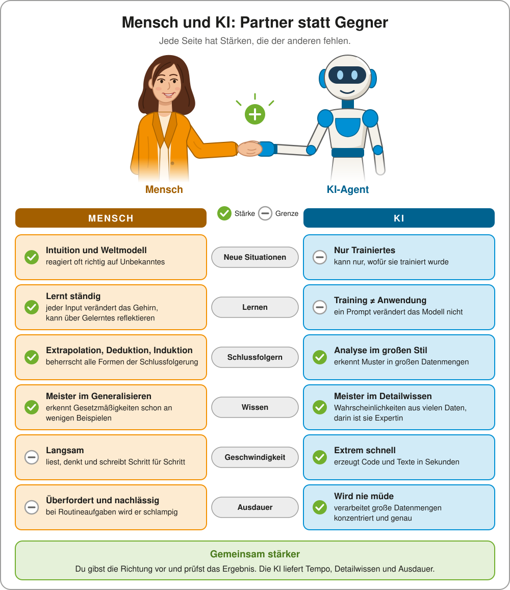

# WMC im 5. und 6. Semester AIF/KIF, 7. und 8. Semester BIF/CIF und 4./5. JG HIF



## Installation der Software

Siehe [software.md](software.md).

## JavaScript Sprachgrundlagen
- [Intro](10_JavaScript/10_ECMAscript.md)
- [Variablen und Datentypen](10_JavaScript/20_Variables.md)
- [JSON, Arrays und Sets](10_JavaScript/30_JSON_Arrays.md)
- Funktionen
  - [Callbacks und Closures](10_JavaScript/40_FunctionsCallback.md)
  - [Prototype, this und new](10_JavaScript/41_FunctionsPrototype.md)
  - [Arrow functions und Arraymethoden](10_JavaScript/42_FunctionsArrowFunctions.md)

## Typescript
- [Die erste Typescript App](./20_Typescript/10_FirstApp.md)
- [Typescript Basics](./20_Typescript/20_TypescriptBasics.md)
- [Module: Code auf mehrere Dateien aufteilen](./20_Typescript/22_Modules.adoc)
- [Vite: Module im Browser verwenden](./20_Typescript/23_Vite.adoc)
- [Typescript und API](./20_Typescript/25_TypescriptWithApi.md)
- **Vertiefung in Typescript**
  - [Object und Array destructing](./20_Typescript/30_Destructing.md)
  - [TypeScript Language Overview](./20_Typescript/40_Typescript_Language.md)
  - [TypeScript Questions and Exercises](./20_Typescript/45_Typescript_Exercises.md)
  - [FrontEnd Tooling Guide](./20_Typescript/50_Frontend_Tooling.md)
  - [FrontEnd Tooling Questions and Exercises](./20_Typescript/55_Frontend_Tooling_Exercises.md)

## 3 Todo App mit Next.js
- 📹 YT: [App Architecture](https://www.youtube.com/watch?v=d1Gd-MGaleE&list=PLUU3EzfPr915ebZONvUVHKm8Bls6D7EgA)
- 📹 YT: [Single Page Applications Architecture](https://www.youtube.com/watch?v=H1NmO3f5oiI&list=PLUU3EzfPr915ebZONvUVHKm8Bls6D7EgA)
- 📹 YT: [Everything You NEED to Know About WEB APP Architecture](https://www.youtube.com/watch?v=sDlCSIDwpDs)
- [Fertiges Backend](30_TodoApp/01_Backend.md)
- [Die erste App mit React und Next.js](30_TodoApp/02_FirstReactApp.md)
- [Layout, Komponenten und Routen](30_TodoApp/10_Layout_Routing.md)
- [Formulare und POST Requests: Daten einfügen](30_TodoApp/20_Add_Form.md)
- [Daten editieren und Komponentenkommunikation](30_TodoApp/30_Edit.adoc)
- [Daten löschen, reducer in React](./30_TodoApp/40_Delete.adoc)
- [Globale States, *useContext()* in React](./30_TodoApp/50_State_Provider.adoc)
  
## 4 Authentication
- [Grundlagen zu Authentication](./50_Authentication/10_AuthenticationPrinciples/README.md)
- [OAuth Programmbeispiel](./50_Authentication/20_Oauth/README.adoc)
- [Next.js mit ASP.NET Core Authentication verbinden](./50_Authentication/30_OauthNextjs/README.adoc)

## 5 Expo (React native)
- [Installation und erste App](./60_Expo/10_first_app.adoc)
- [Löschen und Hinzufügen mit der API](./60_Expo/20_add_delete.adoc)

## Diplomarbeitsvorlage
- [Next.js Projekt Template](./40_DiplomarbeitVorlage/README.md)
- [Microsoft Graph API abfragen](./40_DiplomarbeitVorlage/graph_api.adoc)
- [Docker Container erstellen](./40_DiplomarbeitVorlage/docker.adoc)

## Backends zum Üben
- [Führerscheinprüfung](./90_Exercise/DrivingExamBackend/README.adoc)


## Debugging Next.js in VS Code

Öffne den Ordner mit der Next.js App (nicht den Ordner darüber!) und wähle im Menü *Run* - *Add configuration*.
Wähle *Node.js* als Konfiguration und ersetze den Inhalt der generierten Datei `.vscode/launch.json` durch folgenden Code:

```json
{
    "configurations": [
        {
            "type": "node",
            "request": "launch",
            "name": "⚙️ Internal: Server components",
            "runtimeExecutable": "npm",
            "runtimeArgs": [
                "run",
                "dev"
            ],
            "cwd": "${workspaceFolder}"
        },
        {
            "type": "msedge",
            "request": "launch",
            "name": "⚙️ Internal: Client components",
            "url": "http://localhost:3000",
            "webRoot": "${workspaceFolder}",
            "sourceMaps": true
        }
    ],
    "compounds": [
        {
            "name": "Debug Server and Client",
            "configurations": [
                "⚙️ Internal: Server components",
                "⚙️ Internal: Client components"
            ]
        }
    ]
}
```

Nun kannst du über den Button _Run and Debug_ in der Werkzeugleiste links die Debug Palette öffnen.
Wähle als Startkonfiguration _Debug Server and Client_ (nicht _⚙️ Internal: Server components_).
In der *Debug Console* im unteren Bereich siehst du die Ausgaben.
Wenn der Browser startet, wird die Applikation noch gestartet.
Deswegen kommt am Anfang einmal die Meldung, dass die Seite nicht zur Verfügung steht.
Aktualisiere die Seite, wenn die App gestartet wurde.
